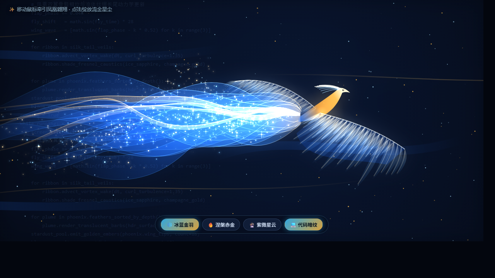

# ✨ Visual Art Gallery — 创意视觉与生成艺术展示仓库

精选并原创打造的 **Python (`turtle` / `tkinter`) + Web (`HTML5 Canvas` / `CSS3`)** 高颜值视觉展示合集。
全部代码 **零第三方依赖**（Python 仅使用标准库，Web 仅使用原生浏览器能力），开箱即用，且可直接开启 **GitHub Pages** 作为在线交互展厅。

---

## 🖼️ 部分效果预览

| 冰蓝流光星尘凤凰 (`Volumetric`) | 黑夜童话圣诞树 (`Turtle`) | 3D 跳动粒子爱心 (`Tkinter`) | 草莓熊手持玫瑰 (`Turtle`) |
| :---: | :---: | :---: | :---: |
|  |  |  |  |

---

## 📂 作品目录（共 39 个精选与原创展示）


### 🌌 殿堂级开源 WebGL / GPGPU 视觉模拟（MIT 协议完整收录）
| 作品 | 路径 | 原作者与亮点说明 |
| :--- | :--- | :--- |
| **Navier-Stokes 流体动力学模拟** | [`web/webgl-fluid/index.html`](web/webgl-fluid/index.html) | [PavelDoGreat/WebGL-Fluid-Simulation](https://github.com/PavelDoGreat/WebGL-Fluid-Simulation) (★16.8k, MIT)。电影级 HDR Bloom 泛光 + Sunrays 体积光束，极度丝滑的发光流体。 |
| **The Spirit — 3D 旋度噪声灵体** | [`web/the-spirit/index.html`](web/the-spirit/index.html) | [edankwan/The-Spirit](https://github.com/edankwan/The-Spirit) (★1.3k, MIT)。WebGL GPGPU FBO + 3D Curl-Noise + 实时体积阴影贴图，空间烟雾灵体。 |
| **Volumetric Particle Flow — 三维体积粒子流** | [`web/volumetric-flow/index.html`](web/volumetric-flow/index.html) | [dli/flow](https://github.com/dli/flow) (★934, MIT)。GPU 实时解算矢量场流体碰撞与光晕散射，立体发光丝绸流线。 |

### 🌐 Web 交互视觉展示（支持 GitHub Pages 在线运行）
| 作品 | 路径 | 亮点 / 原作者说明 |
| :--- | :--- | :--- |
| **极光帷幕** | [`web/aurora-curtain/index.html`](web/aurora-curtain/index.html) | 青绿与紫色的极光在星空下舒卷，层叠光丝组成流动的天幕。 |
| **闪电三角洲** | [`web/lightning-delta/index.html`](web/lightning-delta/index.html) | 蓝紫色电流沿分形树枝由中心向外传播，像夜色中亮起的河流三角洲。 |
| **棱晶阶原** | [`web/prism-terraces/index.html`](web/prism-terraces/index.html) | 等轴测晶柱组成悬浮岛屿，脉冲由中心推向边缘，折出粉紫和冰蓝色阶。 |
| **金角花盘** | [`web/golden-bloom/index.html`](web/golden-bloom/index.html) | 金角排列的种子由内向外发光，织出向日葵般的双向螺旋。 |
| **环面流光** | [`web/torus-knot/index.html`](web/torus-knot/index.html) | 青金粒子沿三绕两回的三维环面纽结追逐，随空间旋转展现交错结构；零依赖，支持暂停与减少动态效果偏好。 |
| **玫瑰弦窗** | [`web/rose-chords/index.html`](web/rose-chords/index.html) | 七瓣极坐标边界上的彩色弦线交织成旋转花窗；零依赖，支持暂停与减少动态效果偏好。 |
| **摆波星阵** | [`web/pendulum-wave/index.html`](web/pendulum-wave/index.html) | 二十四颗青金光摆以不同周期交错成波，六十秒后重新同步；零依赖，支持暂停与减少动态效果偏好。 |
| **日冕光帆** | [`web/corona-sail/index.html`](web/corona-sail/index.html) | 七瓣极坐标曲面由金色与青绿经纬线织成，随旋转舒展呼吸；零依赖，支持暂停及减少动态效果偏好。 |
| **磁场光谱** | [`web/magnetic-bloom/index.html`](web/magnetic-bloom/index.html) | 三维磁偶极场线交织成青金色空间之花，流光沿双极弧线穿行，支持暂停并适配减少动态效果偏好。 |
| **谐振光织** | [`web/harmonic-weave/index.html`](web/harmonic-weave/index.html) | 四组衰减摆线交织成旋转光茧，青蓝、紫红与金色光丝随谐振流动，支持暂停与三套色谱切换。 |
| **潮汐干涉纹** | [`web/wave-interference/index.html`](web/wave-interference/index.html) | 三组同心波叠成青蓝与金色的干涉花纹，拖动水面可移动波源。 |
| **万花筒棱镜穿梭隧道** | [`web/prism-tunnel/index.html`](web/prism-tunnel/index.html) | 零依赖 Canvas 几何光环叠成纵深万花筒隧道，支持鼠标偏转视差、点击切换色谱与空格暂停。 |
| **3D 赛博矩阵数字雨** | [`web/matrix-rain/index.html`](web/matrix-rain/index.html) | 多景深平面的赛博朋克代码流，支持鼠标深度视差透视、点击电磁扰动冲击波与四套霓虹色系切换。 |
| **3D 全息量子能量核心** | [`web/quantum-core/index.html`](web/quantum-core/index.html) | 三轴万向节戴森环与 1400 颗量子星尘环绕的等离子脉冲核心，支持鼠标 3D 悬浮视差与超频过载脉冲。 |
| **黑洞引力透镜与吸积盘** | [`web/black-hole/index.html`](web/black-hole/index.html) | 基于广义相对论测地线光线步进 (Raymarching)，实时渲染事件视界、光子圈、相对论多普勒光变吸积盘与扭曲星空。 |
| **Navier-Stokes 流体动力学模拟** | [`web/webgl-fluid/index.html`](web/webgl-fluid/index.html) | [PavelDoGreat](https://github.com/PavelDoGreat) (★16.8k, MIT)。PavelDoGreat (★16.8k, MIT)。电影级 HDR Bloom 泛光 + Sunrays 体积光束，极度丝滑的发光流体与多触点流光。 |
| **The Spirit — 3D 旋度噪声灵体** | [`web/the-spirit/index.html`](web/the-spirit/index.html) | [Edan Kwan](https://github.com/Edan Kwan) (★1.3k, MIT)。Edan Kwan (★1.3k, MIT)。GPGPU FBO + 3D Curl-Noise + 空间实时体积阴影，几十万发光粒子在三维空间翻涌成烟雾灵体。 |
| **Volumetric Flow — 三维体积粒子流** | [`web/volumetric-flow/index.html`](web/volumetric-flow/index.html) | [David Li](https://github.com/David Li) (★934, MIT)。David Li (★934, MIT)。GPU 实时解算矢量场流体碰撞与光晕散射，鼠标拖拽拉出如烟似绸的发光立体丝带。 |
| **冰蓝金羽·流光星尘凤凰** | [`web/celestial-phoenix/index.html`](web/celestial-phoenix/index.html) | 多层半透明飞羽骨骼拍翼 + 16条丝绸纱幔流体长尾与流金星尘尾迹，支持鼠标牵引翱翔、三套神鸟配色与代码暗纹切换。 |
| **3D 流光旋转粒子圣诞树** | [`web/3d-spiral-tree/index.html`](web/3d-spiral-tree/index.html) | 支持鼠标视差拖拽与三种流光主题切换的 3D 螺旋粒子树与漫天飞雪。 |
| **极光流体引力星云** | [`web/aurora-cosmos/index.html`](web/aurora-cosmos/index.html) | 1500+ 发光粒子构成的流体向量场，支持鼠标漩涡牵引与点击冲击波换色。 |
| **烟花绽放凝聚文字** | [`web/firework-text/index.html`](web/firework-text/index.html) | 漫天彩色烟花升空绽放后自动汇聚成发光祝福文字（支持 ?text=自定义文字）。 |
| **3D 空间烟花与粒子字变换** | [`web/shape-shifter-particles/index.html`](web/shape-shifter-particles/index.html) | 3D 透视网格烟花搭配粒子动态重组倒计时与祝福文字。 |
| **全屏庆典烟花秀** | [`web/fireworks-celebration/index.html`](web/fireworks-celebration/index.html) | 高饱和度多束礼花绽放动画，已彻底净化原文件悬浮广告。 |
| **彩色礼花生日蛋糕** | [`web/cake-confetti/index.html`](web/cake-confetti/index.html) | 字符拆分跳动特效与缤纷纸屑飘落庆典动画。 |
| **霓虹聚光灯扫描特效** | [`web/neon-spotlight/index.html`](web/neon-spotlight/index.html) | 纯 CSS3 clip-path 实现的彩虹霓虹聚光灯扫光文字。 |

### 🐍 Python 桌面动画展示（标准库 `turtle` & `tkinter`，零安装）
| 作品 | 路径 | 亮点说明 |
| :--- | :--- | :--- |
| **60FPS 双星系引力碰撞模拟** | [`python/generative/galaxy_collision_tk.py`](python/generative/galaxy_collision_tk.py) | 1200+ 颗恒星受双超大质量黑洞引力摄动拉出壮丽潮汐尾与引力桥，支持鼠标点击生成临时引力奇点。 |
| **3D 洛伦兹奇异吸引子** | [`python/generative/lorenz_attractor_3d.py`](python/generative/lorenz_attractor_3d.py) | 基于三维投影与 Runge-Kutta 混沌方程实时绘制蝴蝶翅膀，支持鼠标任意拖拽三维视角与变色。 |
| **霓虹万花筒神圣几何曼陀罗** | [`python/generative/neon_mandala_turtle.py`](python/generative/neon_mandala_turtle.py) | 基于 HSV 色彩空间与黄金角螺旋生成的暗黑霓虹几何艺术。 |
| **60FPS 星空引力交互烟花秀** | [`python/generative/starry_fireworks_tk.py`](python/generative/starry_fireworks_tk.py) | 纯标准库 Tkinter 物理粒子烟花，支持鼠标点击任意坐标定制发射。 |
| **3D 跳动粒子光环爱心** | [`python/hearts_and_characters/beating_particle_heart.py`](python/hearts_and_characters/beating_particle_heart.py) | 数千颗粒子按心形参数方程与周期力场呼吸跳动。 |
| **草莓熊手持玫瑰花** | [`python/hearts_and_characters/lotso_bear_rose.py`](python/hearts_and_characters/lotso_bear_rose.py) | 660+ 行精细贝塞尔圆弧绘制草莓熊与多层渐变玫瑰。 |
| **满屏浪漫漂浮爱心** | [`python/hearts_and_characters/floating_hearts.py`](python/hearts_and_characters/floating_hearts.py) | 双缓冲帧动画实现多色爱心正弦摇曳上升。 |
| **黑夜童话装饰圣诞树** | [`python/trees/night_decorated_tree.py`](python/trees/night_decorated_tree.py) | 黑底绿树搭配圣诞帽、拐杖糖、圣诞袜与六角雪花。 |
| **经典分形彩灯落雪圣诞树** | [`python/trees/fractal_christmas_tree.py`](python/trees/fractal_christmas_tree.py) | 递归分形树冠随机点缀彩灯与漫天六角雪花。 |
| **少女粉蝴蝶结圣诞树** | [`python/trees/pink_ribbon_tree.py`](python/trees/pink_ribbon_tree.py) | 粉色系波浪树冠搭配大小蝴蝶结与星星挂饰。 |
| **动态分形樱花落花树** | [`python/trees/sakura_fractal_tree.py`](python/trees/sakura_fractal_tree.py) | 随机分形树干生长与珊瑚粉花瓣飘落。 |
| **浪漫爱心叶片分形树** | [`python/trees/love_heart_tree.py`](python/trees/love_heart_tree.py) | 递归分形枝干末端绽放满树粉红爱心叶片。 |
| **4D 超立方体四维投影翻转** | [`python/generative/tesseract_4d_turtle.py`](python/generative/tesseract_4d_turtle.py) | 16 顶点 32 边四维几何体，在 XW/YW/ZW 四维平面旋转并实时透视投影至 3D 与 2D，呈现内外交替折叠的高维视觉奇观。支持 3D 自由拖拽视角与多套霓虹色系。 |

---

## 🚀 快速开始

```bash
# 1. 启动交互式菜单（可按编号运行任意 Python 动画或打开本地 Web 展厅）
python run.py

# 2. 直接启动本地 Web 展厅并在浏览器打开 index.html
python run.py --web

# 3. 运行仓库代码语法与去广告自检
python run.py --check
```

---

## 🌍 在线展厅与仓库地址

- **GitHub 仓库**：[https://github.com/hellotian523/beautiful-py](https://github.com/hellotian523/beautiful-py)
- **GitHub Pages 在线交互预览**：[https://hellotian523.github.io/beautiful-py/](https://hellotian523.github.io/beautiful-py/)

克隆到本地体验全部 Python 桌面动画：

```bash
git clone https://github.com/hellotian523/beautiful-py.git
cd beautiful-py
python run.py
```
