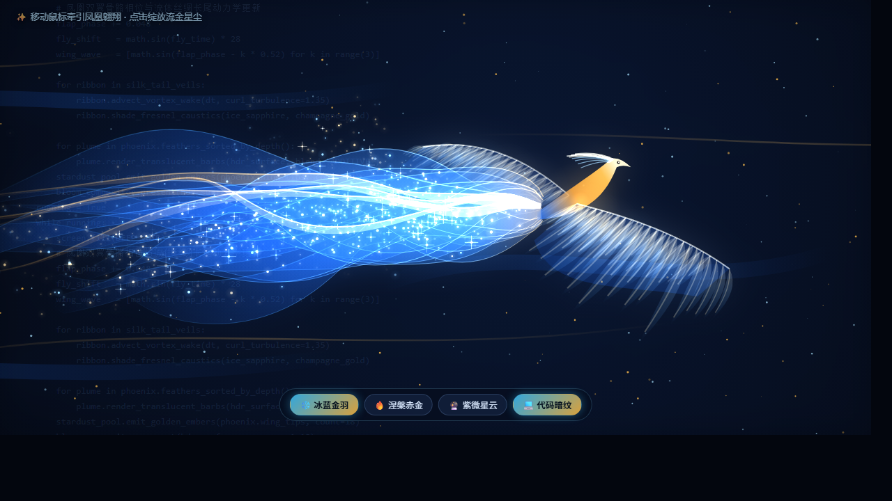

# ✨ Visual Art Gallery — 创意视觉与生成艺术展示仓库

精选并原创打造的 **Python (`turtle` / `tkinter`) + Web (`HTML5 Canvas` / `CSS3`)** 高颜值视觉展示合集。
全部代码 **零第三方依赖**（Python 仅使用标准库，Web 仅使用原生浏览器能力），开箱即用，且可直接开启 **GitHub Pages** 作为在线交互展厅。

---

## 🖼️ 部分效果预览

| 冰蓝流光星尘凤凰 (`Volumetric`) | 黑夜童话圣诞树 (`Turtle`) | 3D 跳动粒子爱心 (`Tkinter`) | 草莓熊手持玫瑰 (`Turtle`) |
| :---: | :---: | :---: | :---: |
|  |  |  |  |

---

## 📂 作品目录（共 18 个精选与原创展示）


### 🌌 殿堂级开源 WebGL / GPGPU 视觉模拟（MIT 协议完整收录）
| 作品 | 路径 | 原作者与亮点说明 |
| :--- | :--- | :--- |
| **Navier-Stokes 流体动力学模拟** | [`web/webgl-fluid/index.html`](web/webgl-fluid/index.html) | [PavelDoGreat/WebGL-Fluid-Simulation](https://github.com/PavelDoGreat/WebGL-Fluid-Simulation) (★16.8k, MIT)。电影级 HDR Bloom 泛光 + Sunrays 体积光束，极度丝滑的发光流体。 |
| **The Spirit — 3D 旋度噪声灵体** | [`web/the-spirit/index.html`](web/the-spirit/index.html) | [edankwan/The-Spirit](https://github.com/edankwan/The-Spirit) (★1.3k, MIT)。WebGL GPGPU FBO + 3D Curl-Noise + 实时体积阴影贴图，空间烟雾灵体。 |
| **Volumetric Particle Flow — 三维体积粒子流** | [`web/volumetric-flow/index.html`](web/volumetric-flow/index.html) | [dli/flow](https://github.com/dli/flow) (★934, MIT)。GPU 实时解算矢量场流体碰撞与光晕散射，立体发光丝绸流线。 |

### 🌐 Web 交互视觉展示（支持 GitHub Pages 在线运行）
| 作品 | 路径 | 亮点说明 |
| :--- | :--- | :--- |
| **展厅总览主页** | [`index.html`](index.html) | 暗黑毛玻璃作品墙，支持分类筛选与弹窗实时交互预览 |
| **冰蓝金羽·流光星尘凤凰** *(镇馆原创)* | [`web/celestial-phoenix/index.html`](web/celestial-phoenix/index.html) | 3/4 航拍双翼多层飞羽骨骼动力学 + 16 条流体丝绸长尾焦散辉光 + 流金星尘与代码暗纹切换 |
| **3D 流光螺旋粒子圣诞树** *(原创)* | [`web/3d-spiral-tree/index.html`](web/3d-spiral-tree/index.html) | 3D 透视投影螺旋粒子树 + 飘雪 + 鼠标拖拽旋转 + 3 套主题切换 |
| **极光流体引力星云** *(原创)* | [`web/aurora-cosmos/index.html`](web/aurora-cosmos/index.html) | 1500+ 发光粒子流体向量场，支持鼠标漩涡牵引与点击冲击波换色 |
| **烟花绽放凝聚文字** | [`web/firework-text/index.html`](web/firework-text/index.html) | 烟花升空爆炸后粒子自动寻路汇聚成字，支持 `?text=自定义内容` |
| **3D 空间烟花与粒子字变换** | [`web/shape-shifter-particles/index.html`](web/shape-shifter-particles/index.html) | 3D 透视地面烟花 + Shape Shifter 粒子动态重组文字（已离线化修复） |
| **全屏庆典烟花秀** | [`web/fireworks-celebration/index.html`](web/fireworks-celebration/index.html) | 高饱和度多束礼花绽放动画（已移除全部悬浮广告与统计脚本） |
| **彩色礼花生日蛋糕** | [`web/cake-confetti/index.html`](web/cake-confetti/index.html) | 字符拆分弹跳特效与纸屑飘落动画 |
| **霓虹聚光灯扫描文字** | [`web/neon-spotlight/index.html`](web/neon-spotlight/index.html) | 纯 CSS3 `clip-path` 彩虹霓虹聚光灯扫描特效 |

### 🐍 Python 桌面动画展示（标准库 `turtle` & `tkinter`，零安装）
| 作品 | 路径 | 亮点说明 |
| :--- | :--- | :--- |
| **霓虹万花筒曼陀罗** *(原创)* | [`python/generative/neon_mandala_turtle.py`](python/generative/neon_mandala_turtle.py) | HSV 全彩渐变旋轮线 + 黄金角螺旋神圣几何 |
| **60FPS 星空引力交互烟花秀** *(原创)* | [`python/generative/starry_fireworks_tk.py`](python/generative/starry_fireworks_tk.py) | 闪烁星空背景 + 物理重力尾迹粒子，点击任意位置发射烟花 |
| **3D 跳动粒子光环爱心** | [`python/hearts_and_characters/beating_particle_heart.py`](python/hearts_and_characters/beating_particle_heart.py) | 心形参数方程与周期力场呼吸跳动光环 |
| **草莓熊手持玫瑰花** | [`python/hearts_and_characters/lotso_bear_rose.py`](python/hearts_and_characters/lotso_bear_rose.py) | 660+ 行精细圆弧绘制草莓熊与多层渐变玫瑰 |
| **满屏浪漫漂浮爱心** | [`python/hearts_and_characters/floating_hearts.py`](python/hearts_and_characters/floating_hearts.py) | 双缓冲帧动画实现多色爱心正弦摇曳漂浮 |
| **黑夜童话装饰圣诞树** | [`python/trees/night_decorated_tree.py`](python/trees/night_decorated_tree.py) | 黑底绿树配圣诞帽、拐杖糖、圣诞袜与六角雪花 |
| **经典分形彩灯圣诞树** | [`python/trees/fractal_christmas_tree.py`](python/trees/fractal_christmas_tree.py) | 递归分形树冠点缀随机彩灯与漫天落雪 |
| **少女粉蝴蝶结圣诞树** | [`python/trees/pink_ribbon_tree.py`](python/trees/pink_ribbon_tree.py) | 粉色波浪树冠搭配大小蝴蝶结与星星挂件 |
| **动态分形樱花落花树** | [`python/trees/sakura_fractal_tree.py`](python/trees/sakura_fractal_tree.py) | 随机生长分形枝干与珊瑚粉落花 |
| **浪漫爱心叶片分形树** | [`python/trees/love_heart_tree.py`](python/trees/love_heart_tree.py) | 递归树枝末端绽放粉红爱心叶片 |

---

## 🚀 快速开始

```bash
# 1. 启动交互式菜单（可按编号运行任意 Python 动画或打开本地 Web 展厅）
python run.py

# 2. 直接启动本地 Web 展厅并在浏览器打开 index.html
python run.py --web

# 3. 运行仓库代码语法与去广告自检
python run.py --check
```

---

## 🌍 在线展厅与仓库地址

- **GitHub 仓库**：[https://github.com/hellotian523/beautiful-py](https://github.com/hellotian523/beautiful-py)
- **GitHub Pages 在线交互预览**：[https://hellotian523.github.io/beautiful-py/](https://hellotian523.github.io/beautiful-py/)

克隆到本地体验全部 Python 桌面动画：

```bash
git clone https://github.com/hellotian523/beautiful-py.git
cd beautiful-py
python run.py
```
